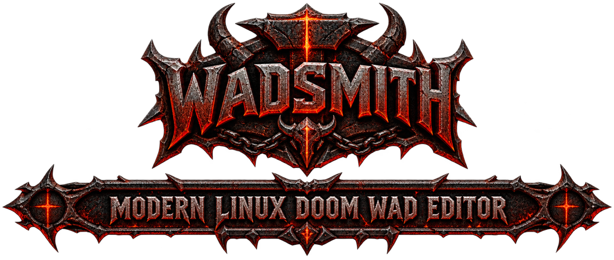
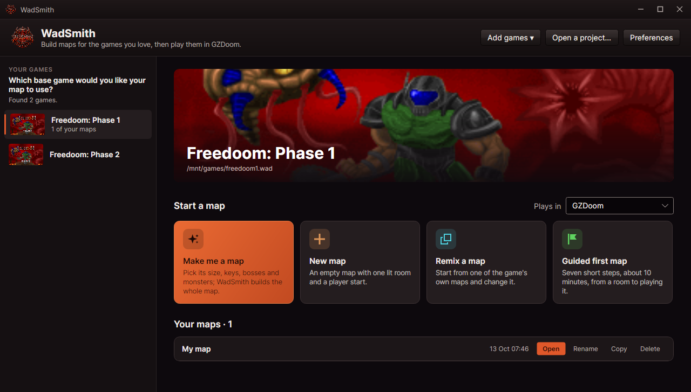

<p align="center">
  
</p>

# WadSmith

A modern map editor for Doom, Doom II, Heretic, Hexen and Strife, built for GZDoom, on Linux and Windows.

WadSmith is meant to be the editor someone who has only ever *played* these games can open and use:
plain words instead of jargon, drag and drop for everything, doors and lifts the editor understands,
and one key to play what you just built. Experienced mappers get the same tools with the teaching
switched off.

> **Status:** 0.0.10, for Linux and Windows. It is early: expect rough edges, and say what you find in [Issues](https://github.com/codingncaffeine/WadSmith/issues).



## What it does

- **Remix or start fresh.** Pick any map of a game you own and make it yours, or start a new one; your game files are never changed.
- **Draw rooms, not lines.** Rooms of any shape, with symmetry, rounded corners and smart guides; drag a room and its walls, textures and monsters move with it, and the rooms beside it stay sealed.
- **Plan and 3D side by side.** A 3D view matched to GZDoom's own picture, where you can drop textures and objects and move floors and ceilings; Tab swaps to it alone.
- **Smart doors, lifts, stairs, windows, switches, secrets, keys, teleporters, exits, lights, platforms and water** made with a click, still editable afterwards, and recognised in maps made elsewhere.
- **Play in one key**, or from wherever the 3D view stands, after a check that offers to fix what would break the game.
- **Plain-language problems** with a fix button, the way from start to exit step by step, and a meter that says whether the ammunition is enough for the monsters.
- **Learn as you go:** a guided first map, hands-on Guide chapters, "What is this?" for anything you point at, examples from the games' own maps, and presets such as Low, Normal, Tall and Huge in place of numbers. Veterans switch the teaching off and get classic names and Doom Builder keys.
- **Free community assets on the shelves.** Pick Realm667 on the Objects shelf for over a thousand free monsters, weapons, items and props, or the community's texture packs on the Textures shelf; drag one in and it is downloaded and copied into your project with its credits.
- **Export for any port.** One file for GZDoom, or a WAD for vanilla, limit-removing, Boom or MBF21 ports with a list of exactly what the map loses, and Play in Chocolate, Crispy or dsda-doom.
- **Never lose work.** Every change is kept as you go, with versions to go back to.

Coming next: a share bundle and drawing in the 3D view.

## Install

- **Arch Linux:** `wadsmith-bin` from the AUR.
- **Debian and Ubuntu:** the `.deb` from the [latest release](https://github.com/codingncaffeine/WadSmith/releases/latest), then `sudo apt install ./wadsmith_*_amd64.deb`.
- **Any Linux:** the tarball from the latest release, unpacked anywhere; run `./wadsmith`.
- **Windows:** the `win-x64` zip from the latest release, unpacked anywhere; run `wadsmith.exe`.

WadSmith needs [GZDoom](https://zdoom.org) to play maps, and SDL2 (optional) plays an object's sound when you point at it.

## Getting started

1. Start WadSmith. It finds the games you have installed; with none, it offers to fetch Freedoom.
2. On a game, choose **Remix a map** to start from one of its maps, **New map** for one lit room, or **Guided first map** for ten minutes of steps beside you.
3. Draw with the **Room** tool on the plan, drop textures and monsters from the **Textures** and **Objects** shelves, and watch it all in the 3D view.
4. Press **F9** to play it in GZDoom. Everything is kept as you go.

The [wiki](https://github.com/codingncaffeine/WadSmith/wiki) covers every tool, shortcut and setting.

## Requirements

- Linux (X11 or Wayland) or Windows 10/11 (64-bit).
- [GZDoom](https://zdoom.org) to play maps.
- The game data from your own copy of Doom, Doom II, Heretic, Hexen or Strife, or the free
  [Freedoom](https://freedoom.github.io). WadSmith ships no game data and never changes your game files.

## Building from source

Requires the .NET 10 SDK.

```sh
git clone https://github.com/codingncaffeine/WadSmith.git
cd WadSmith
dotnet build WadSmith.slnx -c Release
dotnet test tests/WadSmith.Tests -c Release
```

## License

WadSmith is free software under the GNU General Public License, version 3 or later. See [LICENSE](LICENSE).

Doom, Heretic, Hexen and Strife are trademarks of their respective owners. WadSmith is not affiliated
with or endorsed by them.
